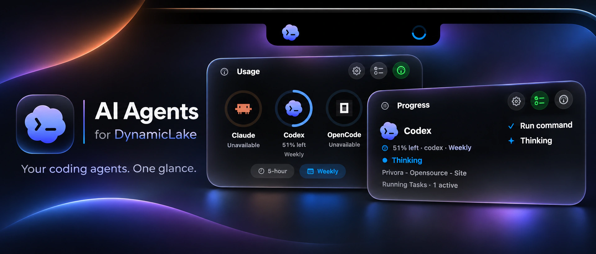

# AI Agents for DynamicLake

  

  <strong>Your coding agents. One glance.</strong> 
  Follow Codex, Claude Code, and OpenCode from your Mac’s notch.

  <a href="https://github.com/rafaelreverberi/dynamiclake-ai-agents-plugin/releases/latest"><strong>Download the latest release</strong></a>
  · <a href="#installation">Installation</a>
  · <a href="docs/SETUP.md">Setup guide</a>
  · <a href="CHANGELOG.md">Changelog</a>

## What you can see

| View | What it shows |
| --- | --- |
| **Progress** | See which agent is running, what it’s doing, and its recent steps. When several sessions are active, use the arrows to switch between them. The compact notch keeps the selected agent in view. |
| **Usage** | See how much of your account quota is left. Tap a ring for its source, time remaining, and reset in your Mac’s local time zone. Missing data appears as **Unavailable**. |
| **Approvals** | With the optional Codex or Claude Code hook enabled, review supported requests in DynamicLake and choose **Approve once** or **Deny**. |

Open AI Agents from **DynaGlance** or assign it as a click Lake. To make Usage the first view between tasks, enable **Show Usage when idle** in the plugin settings.

## Installation

**Requires macOS and a recent version of DynamicLake with JSON plugin support.** The v2.0.2 package runs on Apple Silicon and Intel and includes its Python runtime.

1. Download the plugin ZIP and its SHA-256 checksum from [GitHub Releases](https://github.com/rafaelreverberi/dynamiclake-ai-agents-plugin/releases/latest).
2. In the download folder, verify the ZIP with `shasum -a 256 -c AI-Agents-2.0.2.zip.sha256`. Use the matching checksum filename if you download a different version.
3. Extract the ZIP. In DynamicLake, open **Settings → Plugins → Install Local**, select `AIAgents.dynamiclakeplugin`, and enable it.
4. Open AI Agents from **DynaGlance** or use **Smart Left Click** on its activity.

> **Updating from 2.0.1 or earlier?** If you previously installed optional provider hooks or the Claude Code usage collector, [refresh those integrations once](docs/SETUP.md#update-optional-integrations-from-201-or-earlier). Basic activity tracking needs no extra setup.

If DynamicLake rejects the plugin manifest or only shows a minimal header, update DynamicLake. The full layout requires the host’s `lake` and `lakeLayout` features.

## Connect your agents

Open the **gear** in the AI Agents view for guided setup. Basic progress tracking reads local session data and works without installing hooks.

| Agent | Account usage | Approvals |
| --- | --- | --- |
| **Codex** | Uses your existing Codex sign-in. Shows five-hour and weekly limits when available. | [Optional Codex hook](docs/SETUP.md#codex-usage-and-approvals) |
| **Claude Code** | [Connect Claude usage](docs/SETUP.md#claude-code-usage-and-approvals) to show five-hour and weekly limits for eligible accounts. Setup preserves existing custom status lines. | [Optional Claude Code hook](docs/SETUP.md#claude-code-usage-and-approvals) |
| **OpenCode** | Reads available [Go limits and Console budgets](docs/SETUP.md#opencode-usage) through the OpenCode CLI. Free-model daily counts are unavailable. | Review in OpenCode |

For defaults, upgrades, and removal instructions, see the [setup guide](docs/SETUP.md).

## Privacy and screen sharing

Activity monitoring runs locally. Use the privacy settings to hide file and task names while sharing your screen. **Usage & limits** is on by default and can be turned off in plugin settings. Codex and OpenCode may contact their own services to fetch account limits using their existing sign-in. See the [privacy details](PRIVACY.md) and [security notes](SECURITY.md).

## Project links

[Capabilities](docs/CAPABILITIES.md) · [Architecture](docs/ARCHITECTURE.md) · [Validation](docs/VALIDATION.md) · [Build and release](RELEASING.md) · [Artwork credits](ASSETS.md)

**Licensed for DynamicLake only.** You can clone, build, and modify the code for your own use as a DynamicLake plugin. See the [full license](LICENSE.md) for the terms.

Built independently by Rafael Reverberi. No affiliation with DynamicLake, OpenAI, Anthropic, or OpenCode.
