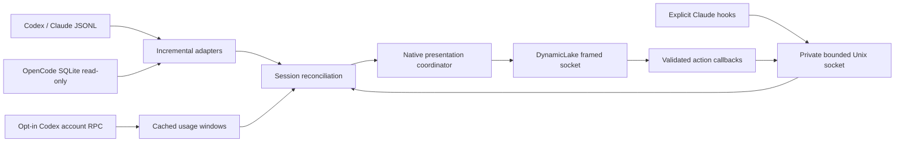

# Architecture

- `ai-agents-monitor.py`: existing import-compatible parsers, settings and framed
  transport; the executable constructs the modular Controller. No bytecode writes.
- Release packages freeze the monitor, hook and setup entry points into one
  universal `ai-agents` executable with a shared bundled Python runtime. Logos
  and setup documentation are resolved beside the installed executable.
- `agent_models.py`: normalized session, task step, capability, usage and permission
  records. Stable activity identity hashes provider+session; turn IDs govern dismiss
  suppression so another event does not revive a dismissed turn.
- `agent_providers.py`: incremental JSONL reader with inode/offset/partial-line and
  truncation handling, factual ID-correlated tool timeline, capped multi-session
  discovery and cached read-only SQLite adapter. Raw prompts/output are discarded.
- `agent_bridge.py`: concurrent current-user Unix IPC, input validation, normalized
  event queue, bounded transient state, a quota-only input that never creates fake work,
  cancellation/timeout/peer-liveness and
  single-use decision routing back to the waiting hook. Multiple pending requests
  are independently reviewable even within the same session.
- `agent_hook.py` / `integrations.py`: provider stdin/stdout contract and explicitly
  invoked reversible configuration merge/uninstall. Normal hook IPC excludes
  prompt/response/output/account fields; permission review is an opt-in exception.
- `agent_usage.py`: independent bounded provider workers initialized over Codex app-server stdio;
  only reads account/rateLimits/read, never starts/resumes/controls an agent thread.
  Last successful windows are cached in memory and become visibly stale.
- `agent_runtime.py`: provider failure isolation, source/privacy settings, stable
  per-session activity reconciliation, real pending-permission pinning, request
  callback validation, deduplicated notifications, reconnection/backoff and signals.
  Explicit capability flags distinguish monitoring, quota, permission control and
  unsupported exact session opening. The two primary views are Progress and Usage.
- `agent_presentation.py`: feature-gated native components; one selected small
  collapsed/Sneak Peek/side capsule, focused Progress/Usage views and Glance. Host owns visual
  chrome. Stable ordering prevents a noisy session from reordering its peers.

File discovery and adapter parsing are synchronous but bounded; account reads run
in one worker and hook handlers use a bounded thread pool. Hook clients never wait
forever. No general shell-execution callback, policy editing, public listener,
transcript persistence, hidden account credential access or cross-user control.
The original parser/payload helper API remains for compatibility; runtime and CLI
presentation use the new coordinator. See CAPABILITIES.md for concrete bounds and
RESEARCH.md for official contracts and unimplemented provider interfaces.

`agent_setup.py` separates provider setup inspection, a short-lived action preview
and explicit application on a worker. Only fixed Claude actions are accepted; no
callback-supplied command runs. An existing custom statusLine is preserved. View
actions publish immediately, and the main loop waits on the socket between polls.
OpenCode usage invokes its own authenticated CLI in standalone mode rather than
reading credentials or controlling the user’s existing session/server.
